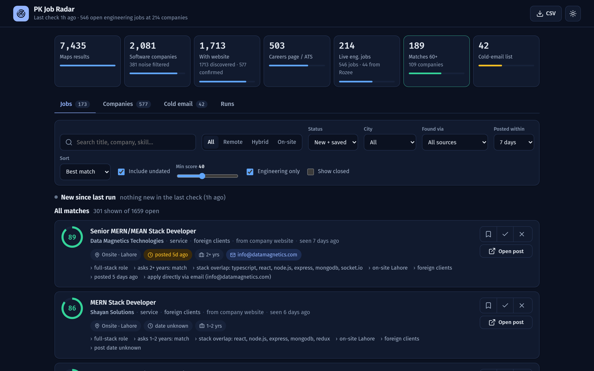
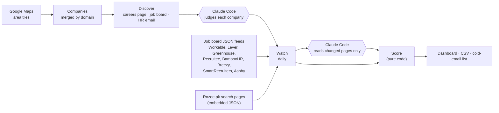
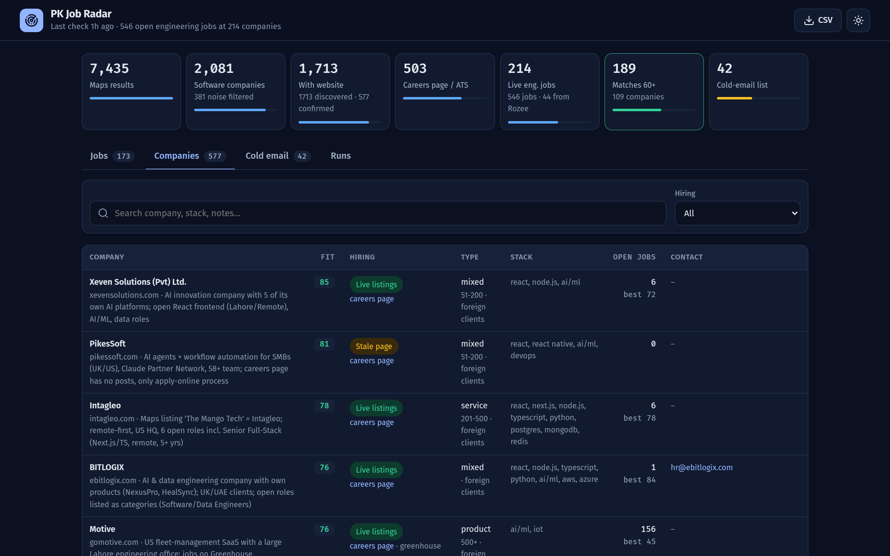

# pk-job-radar

**Finds engineering jobs at Pakistani software companies straight from their own careers pages and job boards, scores each one against your profile, and turns good-fit companies with no openings into a cold-email list.** Local-first, polite to every site it reads, and no paid APIs: the few judgment calls are made by Claude Code in the same session.



[](https://github.com/saqlain-489/pk-job-radar/actions/workflows/ci.yml)

## Numbers from real runs (Lahore and Faisalabad, October 2026)

| Stage | Count |
|---|---|
| Google Maps results for "software house / software company" across tech-hub areas | 7,435 |
| Companies after merging by domain and filtering noise (print shops, phone repair…) | 2,081 |
| Companies with a website, each probed for a careers page, job board and HR email | 1,713 |
| Confirmed software companies | 577 |
| With a careers page or a public job board (Workable, Lever, Greenhouse…) | 503 |
| Open engineering jobs being watched | 546, plus Rozee.pk |
| Jobs that score 60+ for the profile | 189, at 109 companies |

Job boards like Rozee carry a fraction of these: most Pakistani software houses post openings only on their own site.

## How it works



1. **Collect.** Google Maps searches per tech-hub area become companies, merged by domain, with a noise filter for businesses that only look like software houses.
2. **Discover.** Each site is probed for a careers page, a job board (eight providers detected from links and embeds) and a public HR email. Sites with nothing to watch are skipped before any model reads them.
3. **Judge.** Code writes a Markdown packet; Claude Code reads it in the session and writes JSON back: is this a real software company, product or services, foreign clients, stack, hiring status, fit, and a one-line cold-email hook. Code validates the JSON and applies it.
4. **Watch.** Job-board feeds and Rozee's embedded JSON are read in code. Careers pages are reduced to normalised text and hashed, so only pages whose content actually changed are sent for extraction. A quiet day needs zero model work.
5. **Score.** Pure, tested code: stack overlap, experience asked, location and work mode, job age (fresh posts up, month-old posts down), engineering-or-not. A score is never a filter; the reasons are shown next to it.

## Decisions worth a look

- **Model work only where judgment is needed.** Structured sources (job-board JSON, schema.org `JobPosting`, Rozee's embedded data) never reach a model. Free-form careers pages reach one only when their hash changes.
- **Re-reads cannot fake fresh jobs.** A re-worded title ("Sr." vs "Senior") matches the existing job, so its first-seen date and post date survive. Jobs past their closing date close themselves.
- **A thinner page never wipes richer data.** If a later read misses details an earlier one captured (salary, experience, summary), they are kept.
- **Late-loading job lists get one patient browser load** (scroll, "load more", wait for the text to settle). If that reveals more jobs, the company is marked to always render; a failed render skips the day rather than marking every job as removed.
- **Polite by design.** At most one request every 1.5 s per host. A Google Maps budget per session and per day, with an automatic halt the moment results thin out or a CAPTCHA appears. Rozee: one run a day, at most 12 requests, and a 24-hour pause after any block. It never tries to get past a site's protection.
- **Safety nets.** Every command that writes backs up the SQLite database first (last 30 kept). Every Claude step is a file on disk, so an unapplied packet is simply re-sent next time.

## Setup

```bash
npm install
cp config/profile.example.json config/profile.local.json
npm test
```

Edit `config/profile.local.json` with your own details (it is gitignored). Cities, tech-hub areas and search terms live in `config/cities.json`; Rozee cities and queries in `config/rozee.json`.

## Commands

| Step | Command | What it does |
|---|---|---|
| Collect | `npm run collect -- lahore` | Google Maps area searches → companies merged by domain |
| Discover | `npm run discover -- --limit=50 --city=lahore` | Probes each site for careers pages, job boards and HR emails, writes a judging packet |
| Watch | `npm run watch` | Re-reads job-board feeds and careers pages; only changed pages need extraction |
| Rozee | `npm run rozee` | Reads Rozee.pk search results (one city per day) |
| Status | `npm run status` | Funnel numbers and the best new matches |
| Dashboard | `npm run dashboard` | http://localhost:4317: jobs, companies, cold-email drafts |
| Export | `npm run export` | CSV of open jobs |
| Tests | `npm test` | node:test suite with recorded fixtures, no network |

Discover and watch write Markdown packets to `data/work/`. Judging companies and extracting jobs from free-form careers pages is done by reading the packet (designed for Claude Code) and writing the JSON answer next to it; then `npm run discover:apply -- <runId>` / `npm run watch:apply -- <runId>`. The rules are in `docs/discover-rubric.md` and `docs/extract-rules.md`.



## Be polite

- Google Maps: keep to ~30 searches per session, sessions ≥4 hours apart. The collector stops on a CAPTCHA or throttling; don't retry that day.
- Company sites are fetched at most once every 1.5 s per host; Rozee at most 12 requests a day.
- The tool never submits applications or sends email. Drafts are for you to review and send.

## License

MIT © 2026 Saqlain Ahmad
